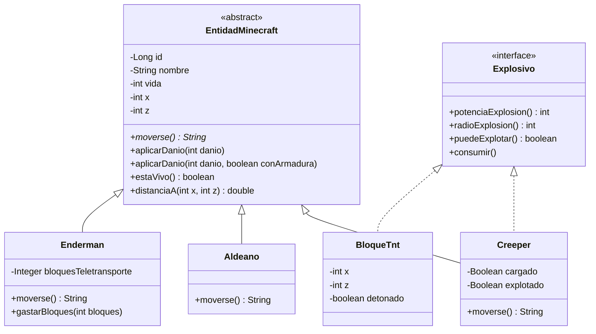

# Bitácora - Taller Git 2026

Repositorio: <https://github.com/javifacha123/ja-taller-git-2026>
Autor: Javier Atlasovich · Dominio elegido: **Minecraft** · Trabajo **individual**

Esta bitácora es un registro cronológico: cada entrada describe el estado del
proyecto **en ese momento**. Al final, la sección «Estado actual» describe cómo
está el código hoy, que es lo que hay que leer para saber qué hace el servicio.

---

## POO-06 — Modelado, paquetes y constructores

**Qué se hizo.** Se creó el proyecto Spring Boot (Java 21, Maven, Spring Web)
desde start.spring.io y se verificó con `./mvnw spring-boot:run`. Se modeló la
familia de entidades de Minecraft con una clase abstracta `EntidadMinecraft`
(atributos privados `nombre` y `vida`, método abstracto `moverse()`) y las
hijas `Creeper`, `Aldeano` y `Enderman`, cada una con su propia versión de
`moverse()`. Se organizaron las clases según el template de paquetes
(`py.edu.uc.lp3.domain`, `py.edu.uc.lp3.rest.controller`).

Se agregaron constructores simples y sobrecargados, la sobrecarga del mensaje
de daño (con y sin armadura), un `IndexController` con `GET /` y un
`MinecraftController` con `GET /minecraft/entidad`, que construye una instancia
a partir de los parámetros de la URL y devuelve su estado y su comportamiento
en JSON.

**Cómo se probó.** Con `curl` contra el servicio levantado, comprobando que un
Creeper y un Aldeano con la misma vida devolvieran movimientos distintos, que
es la sobreescritura funcionando.

**Corrección recibida:** 23/24 → 4.8/5. La única observación fue sobre la
bitácora (un bloque Mermaid sin cerrar y contenido desactualizado respecto del
código). Esta reescritura cierra esa observación: los bloques están cerrados y
el estado real del proyecto se describe al final, en «Estado actual».

---

## POO-08 — CRUD, H2, excepciones e Insomnia

**Qué se hizo.** El servicio pasó a guardar su estado en una base **H2 en
archivo**. La familia `EntidadMinecraft` se convirtió en entidades JPA con
estrategia `SINGLE_TABLE` y columna discriminadora, y se sumó la posición en el
mundo (`x`, `z`). Se agregaron:

- **CRUD REST completo** sobre la familia (padre y tres hijas): POST, GET de la
  colección y del ítem, PATCH y DELETE.
- **Interface de dominio `Explosivo`**, implementada por dos familias
  distintas: `Creeper` (un mob) y `BloqueTnt` (un bloque), con el endpoint
  `GET /api/explosivos` que las lista juntas hablándoles solo por la interface.
- **Dos reglas del juego** que alimentan una simulación persistida: la onda
  expansiva y el esquive del Enderman.
- **Jerarquía de excepciones** del dominio (`MinecraftException` abstracta con
  `EntidadInvalidaException`, `EntidadNoEncontradaException` y
  `ExplosionImposibleException`) y un `@ExceptionHandler` por tipo.
- **Colección de Insomnia** versionada en `insomnia/`.

**Corrección recibida:** 19/24 → 7.9/10, con tres observaciones.

---

## POO-08 (corrección) — Cierre de las tres observaciones

Las tres observaciones del documento de corrección quedaron cerradas antes de
encarar POO-09. El detalle está en la tabla «Situación de POO-08» del README;
en resumen:

1. **Faltaba la capa de servicios en el CRUD.** Se crearon `EntidadService`,
   `TntService` y `ExplosivoService` con sus implementaciones, y se amplió
   `SimulacionService`. Los cinco controllers quedaron sin ninguna referencia a
   un repositorio.
2. **El dominio lanzaba excepciones y tenía lógica de negocio.** Las entities
   quedaron solo con estado (cero `throw` en `domain/` y en `rest/dto/`). Las
   validaciones pasaron al service, y las dos reglas del juego se convirtieron
   en una jerarquía propia de la capa de servicios: `ReglaExplosion` abstracta,
   con `ReglaOndaExpansiva` y `ReglaEsquiveEnderman`, que hereda de la primera y
   sobreescribe `aplicar`.
3. **Documentación.** Se corrigió el código para que el README fuera exacto
   (ahora las cuatro clases de la familia delegan con `this(...)`), se barrieron
   las tildes de todo el repositorio y se reescribió el Javadoc que la
   refactorización había dejado desactualizado.

**Cómo se verificó que no se rompió nada.** Se levantó el servicio contra una
base en memoria y se reprodujo el escenario que el docente había verificado:
el Creeper le hace 8 de daño al Aldeano (vida 20 → 12), el Enderman esquiva
gastando 2 bloques y salta a (4,0) con 6 bloques, la TNT le hace 9 de daño al
Aldeano (vida 3) y el Enderman vuelve a esquivar gastando 4 bloques hasta
(8,0). Los tres errores siguieron respondiendo 409, 400 y 404 con sus códigos.
Todos los números coincidieron con los de la corrección.

---

## POO-09 — APIs cruzadas

**Qué se hizo.**

- Se publicó el **OpenAPI** del servicio con `springdoc-openapi` 3.2.1 (la serie
  3.x es la que acompaña a Spring Boot 4; la 2.x es para Boot 3 y deja
  `/v3/api-docs` en 404). El documento queda en `/v3/api-docs` y navegable en
  `/swagger-ui.html`, y su descripción explica las dos reglas con su fórmula y
  la tabla de códigos de error, para que se entienda sin abrir el código.
- Las **dos reglas pasaron a ser invocables por HTTP**
  (`POST /api/reglas/onda-expansiva` y `POST /api/reglas/esquive-enderman`), que
  es lo que consulta un compañero. Responden 200 al aceptar y 400
  `REGLA_RECHAZADA` al rechazar. Para no duplicar la lógica, las dos fórmulas
  quedaron como métodos estáticos de `ReglaExplosion`: las usan tanto la
  simulación interna como estos endpoints.
- Se agregó el **escenario cruzado** `POST /api/escenarios`: un Creeper detona y
  la onda alcanza a un Aldeano y a un Enderman; la jugada se guarda solo si A2
  acepta el daño del Aldeano y A3 acepta el esquive del Enderman.
- Dos excepciones nuevas con su handler: `CompaneroRechazoException` (409, el
  compañero dijo que no) y `CompaneroInaccesibleException` (502, no hubo nadie
  del otro lado). Las dos guardan el rol, así que el JSON dice si falló A2 o A3.
- Las URLs de los compañeros se configuran con el prefijo `companeros` y se
  pueden pisar al arrancar: no hay ninguna URL escrita a mano en el código.

**Cómo se probó.** Apuntando A2 y A3 al propio servicio (los endpoints de
reglas aceptan los campos que el escenario envía), contra una base en memoria:

| Prueba | Resultado |
|---|---|
| Escenario feliz | 201, jugada guardada con 8 de daño y 2 bloques, con los dos veredictos registrados |
| Rechazo de A2 (Aldeano fuera del radio) | 409 `COMPANERO_RECHAZO`, atribuido a **A2** |
| Rechazo de A3 (Enderman con 1 bloque y necesita 2) | 409 `COMPANERO_RECHAZO`, atribuido a **A3** |
| Historial tras los dos rechazos | **una sola** jugada: ningún rechazo dejó nada escrito |

---

## Estado actual del proyecto

- **Dominio** (`domain`): `EntidadMinecraft` abstracta con `Creeper`, `Aldeano` y
  `Enderman`; la interface `Explosivo` implementada por `Creeper` y `BloqueTnt`;
  `Explosion` con sus `Impacto`; y `Jugada`, el registro del escenario. Son
  entities: **solo estado**, sin validaciones ni excepciones.
- **Servicios** (`service` / `service.impl`): `EntidadService`, `TntService`,
  `ExplosivoService`, `SimulacionService`, `ReglaService` y `EscenarioService`.
  Acá viven las validaciones, las excepciones, las transacciones y las dos
  reglas del juego (`ReglaExplosion` → `ReglaOndaExpansiva` →
  `ReglaEsquiveEnderman`).
- **Controllers** (`rest.controller`): solo traducen HTTP; ninguno toca un
  repositorio.
- **Excepciones** (`exceptions`): `MinecraftException` abstracta con cinco
  hijas, cada una con su `@ExceptionHandler`.
- **Persistencia**: H2 en archivo (`data/minecraft-db`), con la consola en
  `/h2-console`.

### Diagrama de la jerarquía de entidades

El diagrama completo, con la capa de servicios, los repositorios, los
controllers y las excepciones, está en el README.

---

## Asistencia de inteligencia artificial

El enunciado pide declarar la marca del asistente, el modelo exacto y un
resumen de los prompts. Hay una entrada por entrega.

### POO-06

- **Marca:** Claude (Anthropic), en la aplicación web claude.ai.
- **Modelo exacto:** Claude Sonnet 5.5
- **Resumen de prompts:**
  1. Revisar el repositorio y la bitácora de la tarea anterior y decir si estaban completos.
  2. Armar la bitácora en un documento listo para entregar.
  3. Una guía paso a paso para hacer el ejercicio en la máquina virtual con Lubuntu.
  4. Fui pegando las salidas de la terminal (estructura, código, errores) para mover las clases a los paquetes `domain` y `rest.controller` según el template.
  5. Adaptar a mi código los constructores simples y sobrecargados, la sobrecarga del mensaje de daño y el controller con parámetros opcionales.
  6. Ayuda para redactar el README (diagrama Mermaid y apartado de sobrecarga y sobreescritura).
- **Qué hice yo:** ejecuté todos los comandos en mi VM, compilé, probé con `curl` y revisé los resultados antes de cada commit.

### POO-08

- **Marca:** Claude (Anthropic), en la aplicación claude.ai, con acceso a mi repositorio de GitHub.
- **Modelo exacto:** Claude Opus 5.5 (`claude-opus-5-5`)
- **Resumen de prompts:**
  1. Le pasé el enunciado, la rúbrica y el template de paquetes y le pedí ayuda para hacer el trabajo completo sobre mi modelado de Minecraft.
  2. Conecté mi cuenta de GitHub para que leyera el repositorio y partiera de mis clases de POO-06.
  3. Le pedí agregar JPA y H2, convertir la familia en entidades sin romper el ocultamiento, sumar la interface `Explosivo`, las dos reglas de explosión, la jerarquía de excepciones con un handler por tipo y la colección de Insomnia.
  4. Le pedí el README con el diagrama Mermaid y las respuestas a «Qué hay que pensar», la bitácora y el documento de especificaciones.
- **Cómo se verificó:** el asistente no podía descargar dependencias de Maven en su entorno, así que compiló contra versiones mínimas de las APIs y corrió la simulación en Java puro para comprobar los números del README. Yo arranqué el servicio en mi máquina, recorrí la colección de Insomnia, abrí la consola de H2 y revisé el código antes de unir la rama.

### POO-09 (y cierre de las observaciones de POO-08)

- **Marca:** Claude (Anthropic), en la aplicación claude.ai.
- **Modelo exacto:** Claude Opus 5 (`claude-opus-5`)
- **Resumen de prompts:**
  1. Le pasé los cuatro enunciados de la materia, mis dos entregas anteriores y los dos documentos de corrección del docente, y le pedí un diagnóstico de qué me faltaba y cuánto valía cada cosa.
  2. Le pedí cerrar las tres observaciones de la corrección de POO-08 sin cambiar el comportamiento observable del servicio.
  3. Le pedí publicar el OpenAPI y exponer mis dos reglas como endpoints invocables.
  4. Le pedí el escenario cruzado con los clientes HTTP hacia A2 y A3, con las URLs configurables y la atribución del rechazo.
  5. Le pedí actualizar el README y esta bitácora, y le fui pegando las salidas de `./mvnw`, de `curl` y de `git` para que corrigiera lo que hiciera falta.
- **Cómo se verificó:** el asistente tampoco podía compilar en su entorno (el proxy le bloquea Maven Central), así que entregó los cambios como parches de Git y **yo los apliqué, compilé y probé en mi máquina virtual**. Cada bloque se verificó con `curl` antes de seguir: las dos reglas por HTTP, la simulación completa contra una base en memoria comparando con los números de la corrección, y el escenario cruzado con su caso feliz y los dos rechazos. Las salidas de esas pruebas están resumidas en las tablas de arriba.
