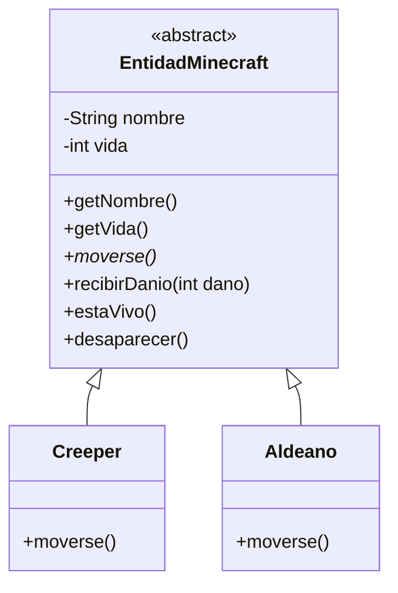

# Bitácora - Taller Git 2026

## Repositorio

https://github.com/javifacha123/ja-taller-git-2026

## Objetivo

Desarrollar y publicar un servicio REST con Spring Boot que modele entidades de Minecraft utilizando herencia, sobreescritura, polimorfismo y ocultamiento de información.

## 1. Creación del proyecto

Se creó un proyecto Spring Boot utilizando:

- Java 21
- Maven
- Spring Web

Se verificó el funcionamiento de la aplicación mediante:

./mvnw spring-boot:run

## 2. Modelo de dominio

Se creó la clase abstracta `EntidadMinecraft`, que contiene los atributos comunes `nombre` y `vida`.

Los atributos son privados, aplicando ocultamiento de información.

La clase define los siguientes comportamientos:

- `moverse()`
- `recibirDanio()`
- `estaVivo()`
- `desaparecer()`

El método `moverse()` es abstracto y debe ser implementado por las clases hijas.

## 3. Herencia y sobreescritura

Se crearon dos clases que heredan de `EntidadMinecraft`:

- `Creeper`
- `Aldeano`

Cada clase sobrescribe el método `moverse()` para proporcionar un comportamiento diferente.

## 4. Polimorfismo

El controlador utiliza una referencia del tipo padre:

`EntidadMinecraft entidad;`

La referencia puede contener una instancia de `Creeper` o `Aldeano`.

Al ejecutar `entidad.moverse()`, se ejecuta automáticamente el comportamiento correspondiente de la clase concreta.

## 5. API REST

Se creó un `IndexController` con el endpoint:

GET /

También se creó `MinecraftController` con:

GET /minecraft/entidad

Ejemplo para un Creeper:

/minecraft/entidad?tipo=creeper&nombre=Creeper1&vida=20

Ejemplo para un Aldeano:

/minecraft/entidad?tipo=aldeano&nombre=Villager1&vida=20

La respuesta se devuelve en formato JSON mostrando los datos y el comportamiento de cada entidad.

## 6. Pruebas

Se verificó el funcionamiento de la API mediante `curl`.

Para un Creeper se obtuvo:

- vida: 20
- vivo: true
- tipo: Creeper
- movimiento: El Creeper se acerca silenciosamente al jugador.

Para un Aldeano se obtuvo:

- vida: 20
- vivo: true
- tipo: Aldeano
- movimiento: El Aldeano camina hacia la aldea.

Estas pruebas permiten comprobar que ambas clases comparten la misma jerarquía y presentan comportamientos diferentes mediante sobreescritura.

## 7. Diagrama de clases

## Asistencia de inteligencia artificial (Tarea POO-06)

- **Marca del asistente:** Claude (Anthropic), en la aplicación web claude.ai.
- **Modelo exacto:** Claude Sonnet 5.5
- **Resumen de prompts:**
  1. Pedí revisar mi repositorio y mi bitácora de la tarea anterior y decirme si estaban completos.
  2. Pedí armar la bitácora en un documento de Word listo para entregar.
  3. Pedí una guía paso a paso para hacer el ejercicio POO-06 en mi máquina virtual con Lubuntu.
  4. Fui pegando las salidas de la terminal (estructura del proyecto, código, errores) para que me ayudara a mover las clases a los paquetes `domain` y `rest.controller` según el template.
  5. Pedí adaptar a mi código los constructores simples y sobrecargados, la sobrecarga de `recibirDanio` y el controller con parámetros opcionales.
  6. Pedí ayuda para redactar el README (diagrama Mermaid y apartado de sobrecarga y sobreescritura) y esta sección de bitácora.
- **Qué hice yo:** ejecuté todos los comandos en mi VM, compilé, probé con curl y revisé los resultados antes de hacer cada commit.

## Asistencia de inteligencia artificial (Tarea POO-08: CRUD, H2 e Insomnia)

- **Marca del asistente:** Claude (Anthropic), en la aplicación claude.ai, con acceso a mi repositorio de GitHub.
- **Modelo exacto:** Claude Opus 5.5 (`claude-opus-5-5`)
- **Resumen de prompts:**
  1. Le pasé el enunciado de POO-08, la rúbrica y el template de paquetes y le pedí ayuda para hacer el trabajo completo sobre mi modelado de Minecraft.
  2. Conecté mi cuenta de GitHub para que leyera el repositorio y partiera de mis clases de POO-06 (`EntidadMinecraft`, `Creeper`, `Aldeano`, `Enderman`).
  3. Le pedí que agregara JPA y H2, convirtiera la familia en entidades sin romper el ocultamiento, sumara la interface `Explosivo` (Creeper y TNT), las dos reglas de explosión, la jerarquía de excepciones con un handler por tipo y la colección de Insomnia.
  4. Le pedí el README con el diagrama Mermaid y las respuestas a "Qué hay que pensar", esta bitácora y el documento de especificaciones para Classroom, con commits separados en una rama.
- **Cómo se verificó:** el asistente no podía descargar dependencias de Maven en su entorno, así que compiló el código contra versiones mínimas de las APIs y corrió la simulación del dominio en Java puro para comprobar los números del README. Yo arranqué el servicio con `./mvnw spring-boot:run` en mi máquina, recorrí la colección de Insomnia, abrí la consola de H2 y revisé el código antes de unir la rama.

